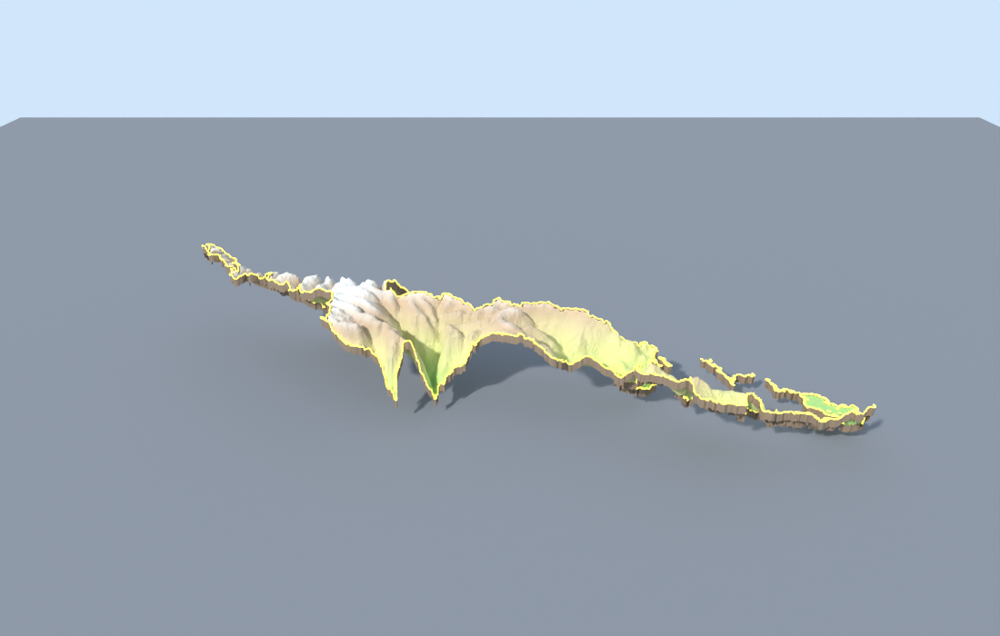
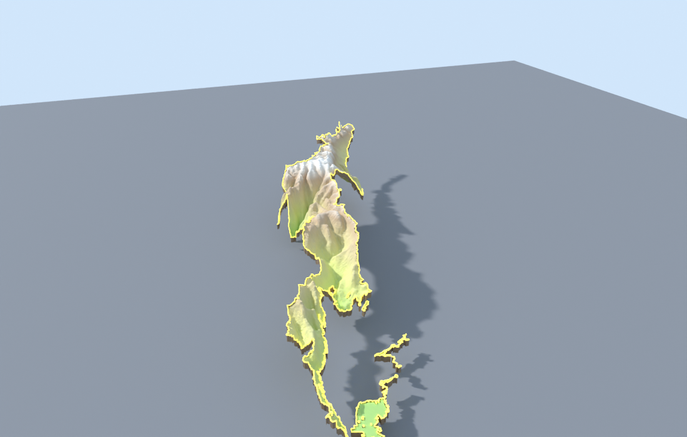
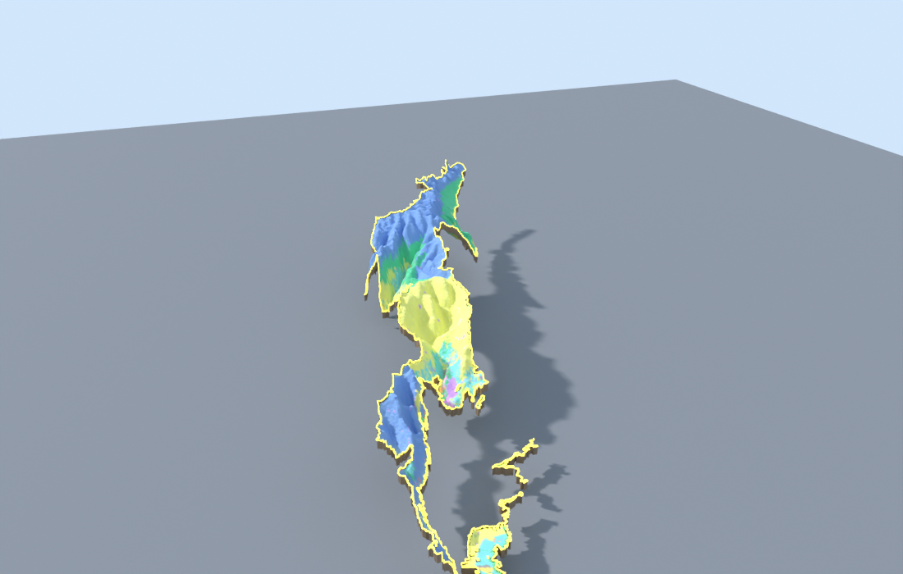
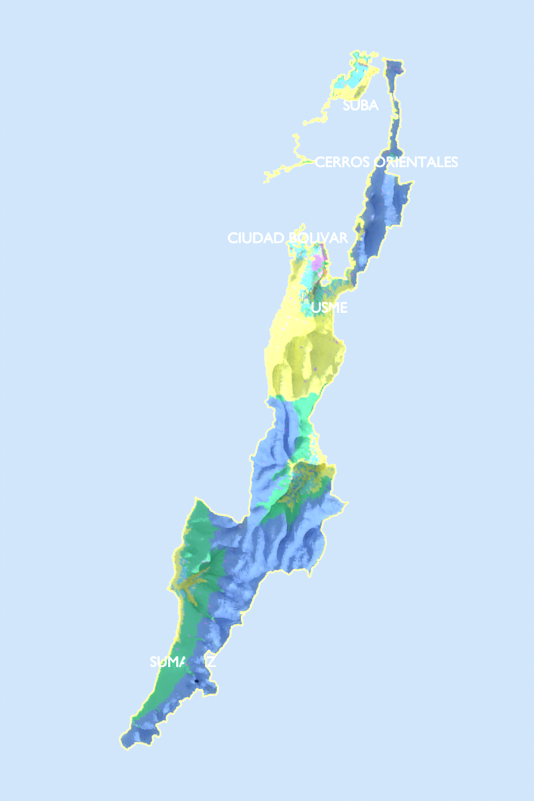
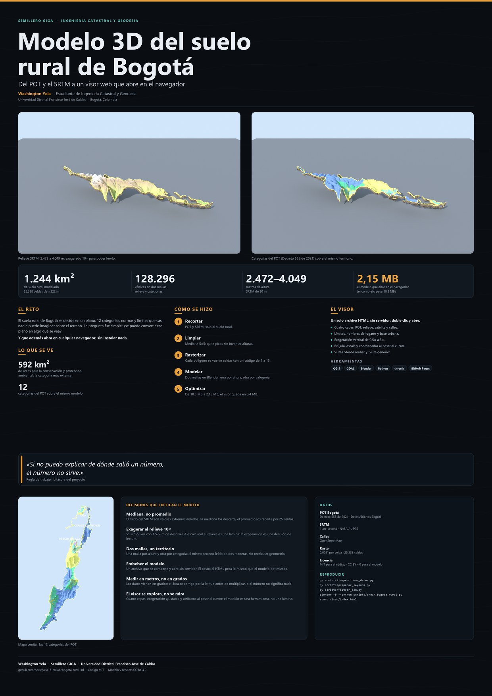

# Modelo 3D del suelo rural de Bogotá

Del POT y el SRTM a un visor web que se abre en el navegador.

**Washington Yela** · Ingeniería Catastral y Geodesia · Semillero GIGA
Universidad Distrital Francisco José de Caldas

[Visor en línea](https://norielyela13-collab.github.io/bogota-rural-3d/) · [Repositorio](https://github.com/norielyela13-collab/bogota-rural-3d)



---

## Qué es esto

Un modelo tridimensional del suelo rural de Bogotá construido **solo con datos
públicos**: las categorías de ordenamiento del POT (Decreto 555 de 2021) y el
relieve del SRTM. No es una maqueta decorativa: cada color corresponde a una
categoría real del POT y cada altura sale de una medición del terreno.

El repositorio incluye las cuatro piezas del trabajo:

1. los **datos** de entrada y los intermedios,
2. los **scripts** que los procesan (Python + Blender),
3. el **modelo** en GLB y el archivo de Blender,
4. el **visor web** de una sola página, listo para GitHub Pages.

---

## El resultado en números

| Dato | Valor |
|---|---|
| Área rural modelada | 25.338 celdas → **1.244 km²** (1.242 km² redondeado en la presentación) |
| Categoría más extensa | Áreas para la conservación y protección ambiental: **592,1 km²** |
| Rango de alturas | **2.472 – 4.049 m** |
| Resolución del ráster | 232 × 553 celdas de 0,002° (≈ 222 m por lado) |
| Vértices del modelo | **128.296** (dos mallas: relieve y categorías) |
| Objetos en la escena | 25 con nombre propio |
| Contornos de límite | 16 |
| Renders | 7 (tres de relieve, tres de categorías, un mapa cenital) |
| GLB completo | **18,3 MB** |
| GLB dentro del visor | **2,15 MB** (embebido en base64) |
| Visor final | **3,43 MB** en un solo HTML |

La diferencia entre 18,3 MB y 2,15 MB es el corazón del proyecto: el modelo
completo sirve para renderizar; el que va al navegador se simplifica y se
comprime hasta que abre rápido sin perder la forma que se ve en pantalla.

---

## Cómo se ve

| Relieve | Categorías del POT |
|---|---|
|  |  |

Mapa cenital con las categorías reales:



Los siete renders están en [`docs/renders/`](docs/renders/). La bitácora del
proceso y la presentación están en [`docs/`](docs/).

## Póster

[](docs/poster.png)

Versión para imprimir en A2 (42 × 59,4 cm, 3508 × 4961 px):
[`docs/poster.png`](docs/poster.png).

---

## Cómo está hecho

```
Datos abiertos                  Procesamiento                 Producto
─────────────                  ─────────────                 ────────
POT 555/2021 (gpkg)  ──┐
SRTM 1 arc-sec       ──┼──►  recorte + reproyección +  ──►  modelo 3D (.blend)
Límite rural         ──┘     mediana 5x5 + rasterizado       ├─ GLB (18,3 MB)
                                                             ├─ 7 renders
                                                             └─ visor web (3,4 MB)
```

### 1. Datos

- **Categorías del suelo rural**: capa `CategoriaSueloRural` de Datos Abiertos
  Bogotá, en el marco del Decreto 555 de 2021. Ocho geometrías que se
  rasterizan a códigos numéricos (1–13) para poder colorear el terreno.
- **Relieve**: SRTM de 1 segundo de arco (NASA/USGS), descargado por teselas.
- **Límite rural**: máscara que recorta el DEM y deja solo el suelo rural.

Todo se trabaja en **WGS84 (EPSG:4326)**, que es como vienen los datos. Para
calcular áreas no se usan los grados: se convierte el tamaño de celda a metros
corrigiendo la longitud por el coseno de la latitud.

### 2. Limpieza del DEM

El SRTM trae picos y pocitos de una sola celda. Un promedio los repartiría por
todo el terreno; la **mediana 5×5** toma el valor central de los 25 vecinos y
elimina el valor extremo sin inventar alturas.

```bash
py scripts/filtrar_dem.py
# Minimo/maximo tras suavizado: 2472 / 4049 m
```

### 3. Construcción del modelo

`scripts/crear_bogota_rural.py` corre dentro de Blender:

```bash
blender --background --factory-startup --python scripts/crear_bogota_rural.py
```

- Crea dos mallas con la misma huella: una coloreada por altura y otra por
  categoría del POT.
- Aplica una **exageración vertical de 10×** para que el relieve se aprecie a
  escala de ciudad (sin exagerar, 1.500 m de diferencia se ven planos en 50 km).
- Agrega límites, etiquetas de lugares, base urbana, luz solar y dos cámaras
  (sobrevuelo y cenital).
- Renderiza con **Cycles** a 1100 × 700 (el cenital a 1000 × 1500).
- Exporta el GLB.

### 4. Publicación

El visor es un único `index.html` con three.js y el modelo embebido. No necesita
servidor ni build: se abre con doble clic. Para publicarlo, el workflow de
[`.github/workflows/pages.yml`](.github/workflows/pages.yml) sube la carpeta
`visor/` a GitHub Pages en cada push a `main`.

---

## El visor

`visor/index.html` incluye:

- **Cuatro capas de terreno**: categorías del POT, relieve SRTM, imagen
  satelital y mapa de calles de OpenStreetMap.
- **Tres capas conmutables**: límites, nombres de lugares y base urbana.
- **Exageración vertical** ajustable entre 0,5× y 3×.
- **Ir a**: acceso rápido a lugares del territorio.
- **Brújula**, **barra de escala** y lectura de coordenadas y atributos al
  pasar el cursor.
- Vistas "desde arriba" y "vista general".

Las capas satelital y de calles se descargan de internet; las capas del POT y
del SRTM funcionan sin conexión porque van dentro del archivo.

---

## Estructura del repositorio

```
.
├── modelo/
│   ├── modelo_bogota_rural.blend     # escena completa de Blender
│   └── modelo_bogota_rural.glb       # malla exportada (18,3 MB)
├── visor/
│   └── index.html                    # visor autocontenido (3,43 MB)
├── scripts/
│   ├── inspeccionar_datos.py         # revisa capas y códigos antes de procesar
│   ├── preparar_leyenda.py           # áreas por categoría + estadísticas del DEM
│   ├── filtrar_dem.py                # mediana 5x5 sobre el SRTM
│   ├── analizar_terreno.py           # extensión y perfil de alturas
│   └── crear_bogota_rural.py         # construcción del modelo en Blender
├── datos_reales/
│   ├── categoriasuelorural.gpkg      # fuente POT
│   ├── clasificacionsuelo_wgs84.geojson
│   ├── rural_mask.geojson            # máscara del suelo rural
│   ├── dem_rural.asc / .tif          # SRTM recortado
│   ├── dem_rural_filtrado.asc        # después de la mediana 5x5
│   ├── categorias_rural_v2.asc / .tif
│   ├── leyenda_base.json             # código → categoría / subcategoría
│   └── leyenda_categorias.json       # resultado con áreas
├── docs/
│   ├── renders/                      # los 7 renders
│   ├── Bitacora_Modelo3D_.pdf
│   └── presentacion.pptx
└── .github/workflows/pages.yml
```

---

## Cómo reproducirlo

Requisitos: Python 3.10+, Blender 4.x o superior y, opcionalmente, QGIS/GDAL
para volver a exportar los datos.

```bash
# 1. Revisar que los datos estén completos
py scripts/inspeccionar_datos.py

# 2. Calcular áreas y estadísticas
py scripts/preparar_leyenda.py

# 3. Suavizar el DEM
py scripts/filtrar_dem.py

# 4. Construir el modelo y renderizar
blender --background --factory-startup --python scripts/crear_bogota_rural.py

# 5. Abrir el visor
start visor/index.html
```

Los scripts no dependen de rutas absolutas: leen y escriben dentro del
repositorio. `crear_bogota_rural.py` usa `datos_reales/dem_rural_filtrado.asc`
y `datos_reales/categorias_rural_v2.asc`.

---

## Decisiones que vale la pena explicar

**¿Por qué mediana y no promedio?**
Porque el ruido del SRTM son valores extremos aislados. El promedio los diluye
pero contamina 25 celdas; la mediana los descarta.

**¿Por qué exagerar el relieve 10×?**
Bogotá rural mide unos 51 × 122 km y el desnivel máximo es de 1.577 m. A escala
real, ese relieve es una lámina. La exageración es una decisión de lectura, no
un dato: por eso el visor la muestra como un control ajustable y no como una
verdad.

**¿Por qué embeber el GLB dentro del HTML?**
Para que el visor sea un solo archivo: se comparte, se abre con doble clic y no
depende de un servidor ni de rutas relativas. El costo es que el HTML pesa lo
mismo que el modelo.

**¿Qué se pierde al bajar de 18,3 MB a 2,15 MB?**
Precisión geométrica que no se ve en pantalla. El modelo completo se conserva
para renderizar; el del visor está simplificado y cuantizado.

**¿Por qué dos mallas idénticas?**
Porque el color por altura y el color por categoría cuentan historias distintas
del mismo territorio. Tenerlas separadas permite alternarlas sin recalcular
geometría.

---

## Datos y créditos

- **POT Bogotá**: Decreto 555 de 2021, capa `CategoriaSueloRural`, Datos
  Abiertos Bogotá.
- **Relieve**: SRTM 1 arc-second, NASA/USGS (vía AWS Terrain Tiles).
- **Calles**: OpenStreetMap.
- **Herramientas**: QGIS/GDAL, Blender, Python, three.js, GitHub Pages.

## Limitaciones

- El modelo representa categorías y relieve; no incluye edificaciones rurales
  ni información predial.
- La exageración vertical es una ayuda visual, no una medida.
- El SRTM tiene 30 m de resolución: no sirve para detalle predial.
- Las áreas se calculan con una corrección por latitud, no con una proyección
  catastral oficial; para cifras con fines jurídicos hay que usar EPSG:3116.

## Autor

**Washington Yela** — estudiante de Ingeniería Catastral y Geodesia,
Semillero GIGA. [@norielyela13-collab](https://github.com/norielyela13-collab).

## Licencia

- **Código** (scripts y visor): MIT. Ver [`LICENSE`](LICENSE).
- **Modelo, renders y textos**: CC BY 4.0 — puedes reutilizarlos citando la
  fuente.
- **Datos de origen**: conservan la licencia de Datos Abiertos Bogotá,
  NASA/USGS y OpenStreetMap.
